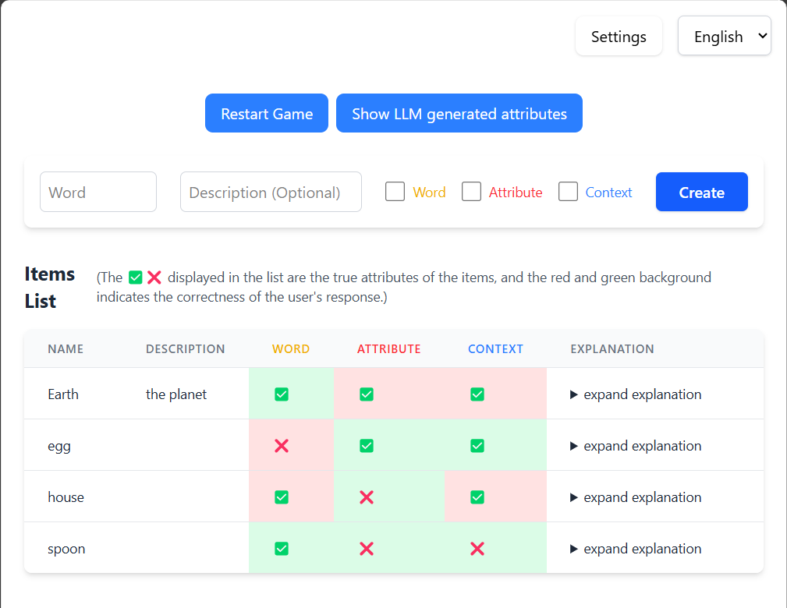
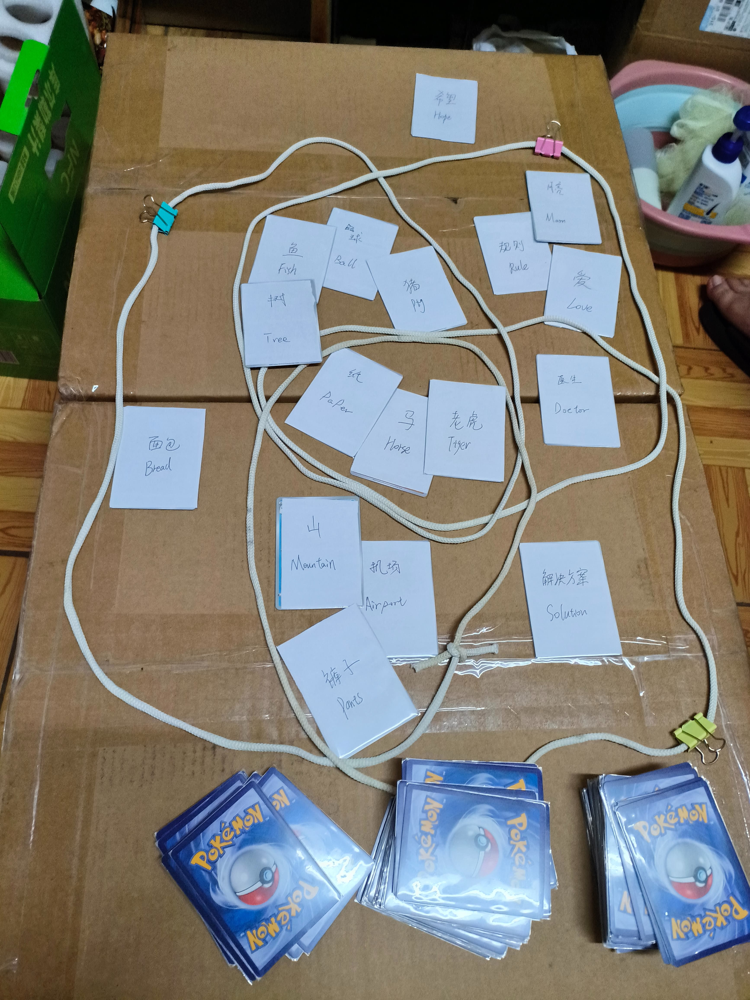

# Thing in Rings

AI-powered _Thing in Rings_ game referee.

You don't need to buy the game; just make some noun cards, take a rope, and play instantly with your friends!

There are two versions: single-player and LAN multiplayer.

## Single-player

Play in the browser at [lxl66566.github.io/thing-in-rings-with-ai](https://lxl66566.github.io/thing-in-rings-with-ai/). The AI referee generates three hidden characteristics and judges every item you place, so you can play the full game with physical cards.

You need an OpenAI-compatible API key; presets are built in for Google AI Studio (free), OpenAI, DeepSeek, OpenRouter, Moonshot Kimi and Zhipu GLM, plus a fully custom endpoint. The key is stored in your browser only.

Run locally: `pnpm install && pnpm dev`, or `pnpm build && pnpm serve`.

## Multiplayer (LAN)

Players join a room by code and take turns answering the same question set on their own devices; the host's LLM generates the characteristics and judges items. Designed for people sitting in the same room — there is no chat. Phones work out of the box.

Run: `pnpm build && pnpm server`, then open the printed LAN address on every device. The host configures an LLM provider in Settings first; all LLM calls happen in the host's browser and API keys never reach the server or other players. Port: `--port <n>` or `PORT`, default `8787`; rooms are in-memory and cleared on restart.

## Pic

That's how I and my friends play it.

